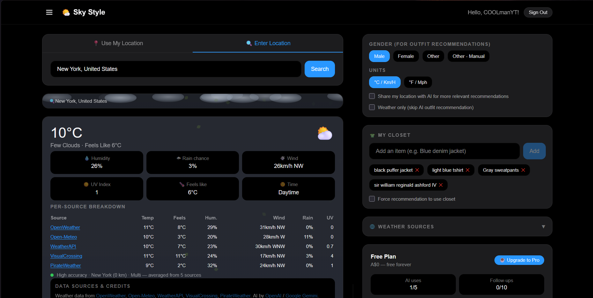
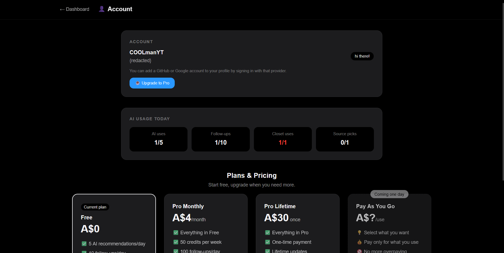

# Sky Style 🌤️

Weather-aware outfit recommendations, your saved wardrobe and clothing search in one app.

**[Open Sky Style](https://skystyle.app)** · **[Documentation](https://docs.skystyle.app)** · **[Setup](SETUP.md)**

## What you can do

- Pick a location and view weather, alerts and hourly forecasts.
- Generate an outfit, refine it with follow-up questions, and use clothes from your Closet.
- Follow clothing links to highlight owned items or prepare a Shop search.
- Search clothing with size, occasion and budget preferences; use direct retailer search when a product source is unavailable.
- Schedule automatic recommendations, manage API keys, and contact support.
- Use the restricted Dev Center for support, publishing, service diagnostics and account tools.

Sign in with GitHub or Google. The account and dashboard show your current usage allowance and credits. Checkout and credit purchases are unavailable. Shop coverage and source availability are described in the [Shop guide](apps/docs/web-app/shop.md).

## Run locally

Follow [SETUP.md](SETUP.md) to install dependencies, configure the web environment and register local sign-in callbacks.

```bash
npm ci
npm run dev
```

Run `npm run docs:dev` for the documentation site; it needs no product credentials.

## Repository map

| Location | Contents |
| --- | --- |
| `apps/web` | Next.js product and the public API at `/api/v1` |
| `apps/docs` | VitePress documentation source |
| `supabase` | Database SQL assets and regression tests |

The stack uses Next.js, React, TypeScript, Auth.js, Supabase, Tailwind CSS and hosted weather/AI providers. The app and docs deploy independently on Vercel. Edit documentation source rather than generated build output.

## Find documentation

| Goal | Guide |
| --- | --- |
| Start using the app | [Getting started](apps/docs/web-app/getting-started.md) |
| Explore Style, Closet and Shop | [Web app guide](apps/docs/web-app.md) |
| Build a public API integration | [Quickstart](apps/docs/api/quickstart.md) and [authentication](apps/docs/api/authentication.md) |
| Use developer tools | [Dev Center](apps/docs/web-app/dev-center.md) |
| Understand the source | [Architecture](apps/docs/development/architecture.md) |
| Verify a change | [Testing](apps/docs/development/testing.md) |

## Contributing

Issues and pull requests are welcome. Update the relevant documentation when behavior changes. Run tests, lint and builds as described in the testing guide. Keep provider keys and database service-role credentials server-side.

## Screenshots

| Dashboard | Account |
| --- | --- |
|  |  |

## Legal

[Terms of Service](https://skystyle.app/terms) · [Privacy Policy](https://skystyle.app/privacy) · [License](LICENSE)
